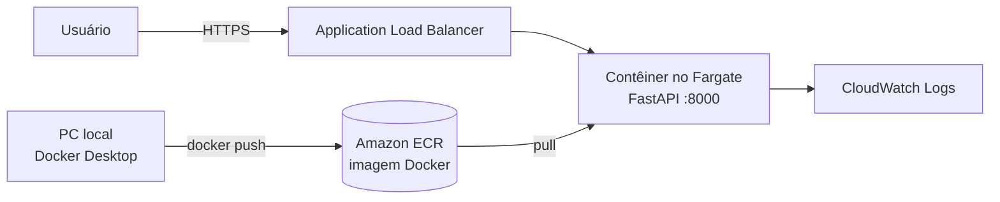

# Timer GTA VI na AWS com ECS Express Mode


Aplicação web simples que mostra uma contagem regressiva para o lançamento do GTA VI (19/11/2026), publicada na AWS em contêiner usando **Amazon ECS Express Mode**.

O objetivo do projeto foi praticar o fluxo completo de publicação de uma aplicação em contêiner na nuvem: código, imagem Docker, registro privado, execução gerenciada, HTTPS, health check e atualização sem indisponibilidade.

## Arquitetura



O ECS Express Mode cria e gerencia automaticamente o cluster, o serviço no Fargate, o Application Load Balancer com certificado HTTPS, o health check, o auto scaling e o grupo de logs.

## Endpoints

| Rota | Descrição |
|---|---|
| `/` | Página com a contagem regressiva |
| `/api/gta6` | Tempo restante em JSON |
| `/health` | Verificação de integridade usada pelo load balancer |

## Tecnologias

Python, FastAPI, Uvicorn, HTML/CSS/JavaScript, Docker, Amazon ECR, Amazon ECS Express Mode, AWS Fargate, Application Load Balancer, AWS IAM, Amazon CloudWatch e AWS CLI.

## Por que ECS Express Mode e não App Runner

O plano inicial era usar o AWS App Runner. Ao criar o serviço, a conta retornou `SubscriptionRequiredException`: a AWS deixou de aceitar novos clientes no App Runner a partir de 30/04/2026. A alternativa recomendada pela própria AWS é o ECS Express Mode, que oferece uma experiência parecida (imagem do ECR para URL pública com HTTPS) dentro do ECS.

## Como rodar localmente

```powershell
docker build -t api-lab-aws .
docker run --rm -p 8000:8000 api-lab-aws
```

Acesse `http://localhost:8000`.

## Como publicar na AWS

Os comandos abaixo foram executados no PowerShell. Substitua `<ACCOUNT_ID>` pelo ID da sua conta AWS. Região usada: `us-east-2` (Ohio).

### 1. Enviar a imagem para o ECR

```powershell
aws ecr create-repository --repository-name api-lab-aws --region us-east-2
aws ecr get-login-password --region us-east-2 | docker login --username AWS --password-stdin <ACCOUNT_ID>.dkr.ecr.us-east-2.amazonaws.com
docker build -t api-lab-aws .
docker tag api-lab-aws:latest <ACCOUNT_ID>.dkr.ecr.us-east-2.amazonaws.com/api-lab-aws:latest
docker push <ACCOUNT_ID>.dkr.ecr.us-east-2.amazonaws.com/api-lab-aws:latest
```

### 2. Criar as roles do IAM

O Express Mode precisa de duas roles: uma de execução de tarefas (baixar a imagem e gravar logs) e uma de infraestrutura (criar o load balancer e demais recursos).

```powershell
@'
{"Version":"2012-10-17","Statement":[{"Effect":"Allow","Principal":{"Service":"ecs-tasks.amazonaws.com"},"Action":"sts:AssumeRole"}]}
'@ | Set-Content -Encoding ascii trust-tasks.json

@'
{"Version":"2012-10-17","Statement":[{"Effect":"Allow","Principal":{"Service":"ecs.amazonaws.com"},"Action":"sts:AssumeRole"}]}
'@ | Set-Content -Encoding ascii trust-infra.json

aws iam create-role --role-name ecsTaskExecutionRole --assume-role-policy-document file://trust-tasks.json
aws iam attach-role-policy --role-name ecsTaskExecutionRole --policy-arn arn:aws:iam::aws:policy/service-role/AmazonECSTaskExecutionRolePolicy

aws iam create-role --role-name ecsInfrastructureRoleForExpressServices --assume-role-policy-document file://trust-infra.json
aws iam attach-role-policy --role-name ecsInfrastructureRoleForExpressServices --policy-arn arn:aws:iam::aws:policy/service-role/AmazonECSInfrastructureRoleforExpressGatewayServices
```

Em contas novas, as service-linked roles podem não existir ainda:

```powershell
aws iam create-service-linked-role --aws-service-name ecs.amazonaws.com
aws iam create-service-linked-role --aws-service-name elasticloadbalancing.amazonaws.com
aws iam create-service-linked-role --aws-service-name ecs.application-autoscaling.amazonaws.com
```

### 3. Criar o serviço

```powershell
@'
{"image":"<ACCOUNT_ID>.dkr.ecr.us-east-2.amazonaws.com/api-lab-aws:latest","containerPort":8000}
'@ | Set-Content -Encoding ascii container.json

@'
{"minTaskCount":1,"maxTaskCount":1}
'@ | Set-Content -Encoding ascii scaling.json

aws ecs create-express-gateway-service --region us-east-2 `
  --service-name api-lab-aws `
  --execution-role-arn arn:aws:iam::<ACCOUNT_ID>:role/ecsTaskExecutionRole `
  --infrastructure-role-arn arn:aws:iam::<ACCOUNT_ID>:role/ecsInfrastructureRoleForExpressServices `
  --primary-container file://container.json `
  --health-check-path "/health" `
  --scaling-target file://scaling.json `
  --monitor-resources
```

A URL pública (`https://<nome>.ecs.us-east-2.on.aws`) aparece na saída e no console do ECS.

### 4. Atualizar a aplicação

```powershell
docker build -t api-lab-aws .
docker tag api-lab-aws:latest <ACCOUNT_ID>.dkr.ecr.us-east-2.amazonaws.com/api-lab-aws:latest
docker push <ACCOUNT_ID>.dkr.ecr.us-east-2.amazonaws.com/api-lab-aws:latest
aws ecs update-service --region us-east-2 --cluster default --service api-lab-aws --force-new-deployment
```

O ECS sobe o novo contêiner, aguarda o `/health` responder e só então desliga o antigo, sem indisponibilidade.

## Problemas encontrados e soluções

| Erro | Causa | Solução |
|---|---|---|
| `SubscriptionRequiredException` no App Runner | App Runner fechado para novos clientes | Migrar para ECS Express Mode |
| `Unable to assume the service linked role` | Service-linked role ausente ou ainda propagando | Criar as roles e aguardar 1 a 2 minutos |
| `failed to connect to the docker API` | Docker Desktop fechado | Abrir o Docker Desktop antes do build |
| `CACHED [4/4] COPY main.py` | Arquivo não foi salvo | Salvar e refazer o build |
| `O nome remoto não pôde ser resolvido` | DNS do load balancer ainda propagando | Aguardar o fim do deploy e limpar o cache de DNS |

## Custos

Este projeto não fica na camada gratuita: o Application Load Balancer e o contêiner no Fargate são cobrados por hora, mesmo sem acessos. Para encerrar, exclua o serviço no ECS e, se quiser, o repositório no ECR.

## Próximos passos

Integrar banco de dados (Amazon RDS PostgreSQL), cache (ElastiCache Redis) e gerenciamento de credenciais (AWS Secrets Manager).
